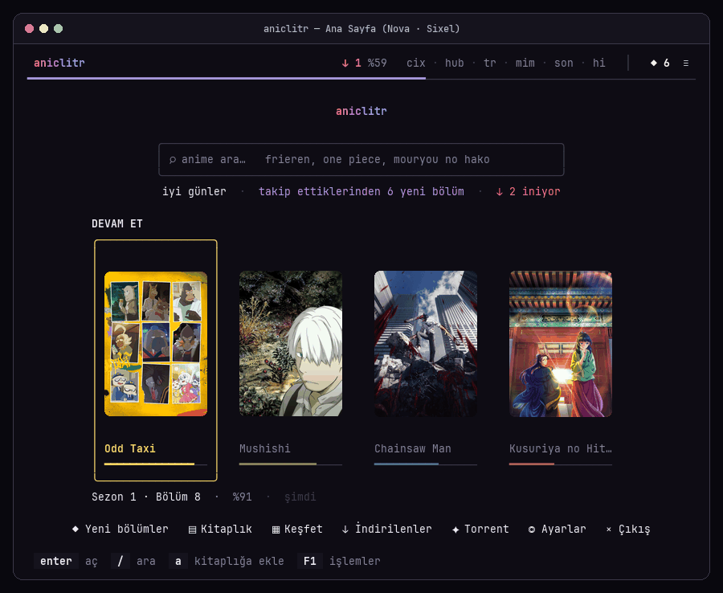
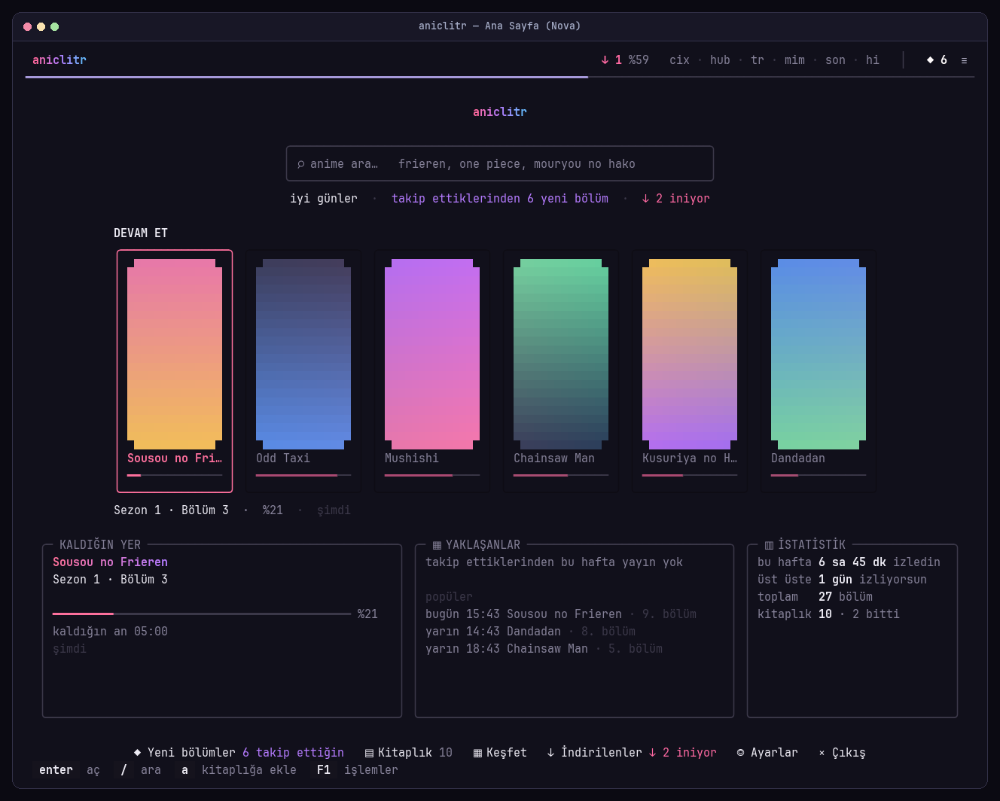
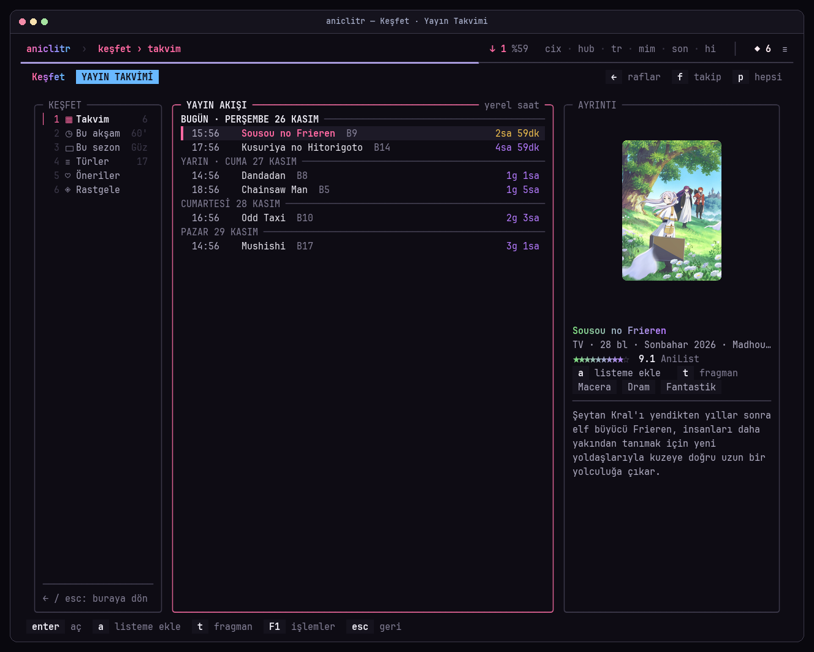
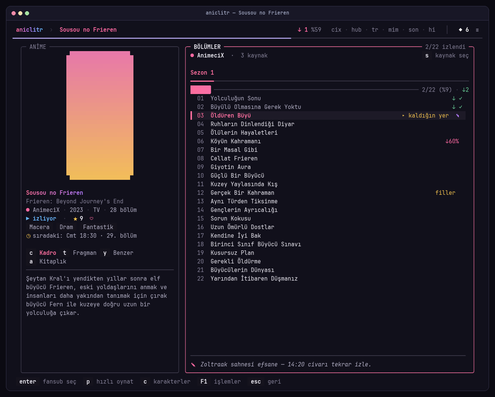
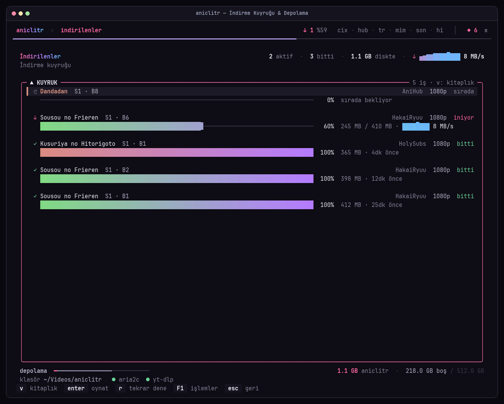

<a id="readme-top"></a>

<div align="center">

[](https://github.com/RobloxPro1453/aniclitr/releases/latest)
[](go.mod)
[](#kurulum)
[](LICENSE)
[](https://github.com/RobloxPro1453/aniclitr/issues)

<br />

# aniclitr

**Türkçe altyazılı anime için klavye-öncelikli, hızlı ve modern terminal oynatıcısı**

[Özellikler](#özellikler) · [Ekran Görüntüleri](#ekran-görüntüleri) · [Kurulum](#kurulum) · [Klavye Kısayolları](#klavye-kısayolları) · [Teşekkürler](#teşekkürler) · [Hata Bildir](https://github.com/RobloxPro1453/aniclitr/issues)

<br />



</div>

---

<details>
<summary><b>İçindekiler</b></summary>

1. [Proje Hakkında](#proje-hakkında)
2. [Ekran Görüntüleri](#ekran-görüntüleri)
3. [Özellikler](#özellikler)
4. [Kurulum](#kurulum)
5. [Hızlı Başlangıç](#hızlı-başlangıç)
6. [Arayüz ve Ekranlar](#arayüz-ve-ekranlar)
7. [Klavye Kısayolları](#klavye-kısayolları)
8. [Altyazı Desteği (AniSub & Yerel Dosya)](#altyazı-desteği-anisub--yerel-dosya)
9. [Kaynaklar ve Yerel Çözücüler](#kaynaklar-ve-yerel-çözücüler)
10. [MyAnimeList Entegrasyonu](#myanimelist-entegrasyonu)
11. [İndirme ve Çevrimdışı Kullanım](#i̇ndirme-ve-çevrimdışı-kullanım)
12. [Görünüm ve Temalar](#görünüm-ve-temalar)
13. [Yapılandırma](#yapılandırma)
14. [Sorun Giderme](#sorun-giderme)
15. [Geliştirme](#geliştirme)
16. [Teşekkürler](#teşekkürler)
17. [Lisans ve Sorumluluk Reddi](#lisans-ve-sorumluluk-reddi)

</details>

---

## Proje Hakkında

**aniclitr**; canlı kaynaklarda anime arama, çeviri grubu (fansub) seçimi, `mpv` ile oynatma, topluluk altyazı yükleme, toplu/aralıklı indirme, karakter kadrosu inceleme ve MyAnimeList eşitlemeyi tek bir hafif Go terminal uygulamasında birleştirir.

Kalınan saniye, seri bazlı çözünürlük tercihi, çok sezonlu seri hizalaması ve açılış/bitiş (OP/ED) jenerik atlama otomatik yönetilir; oynatma sırasında terminal boşa çekilir ve işlemci kullanmaz.

> **English summary.** `aniclitr` v1.0 is an open-source (GPL-3.0), keyboard-driven Go terminal anime player built for Turkish-subtitled content. It searches six live sources in parallel (AnimeciX, AnimeTR, AniHub, SonAnime, Animim, HiAnime) plus Nyaa.si torrents, resolves streams natively in Go (Tau Video, AniHub HLS, OK.ru, Google Drive, Sibnet, Voe, Vidmoly), plays via `mpv` with Discord Rich Presence, loads Turkish subtitles on the fly from [AniSub](https://anisub.co/) directly inside mpv's OSD or from local `.srt`/`.ass`/`.vtt` files with live sync fine-tuning, skips OP/ED via AniSkip & source timestamps, supports batch/range offline downloads with a live speed sparkline & disk-usage bar, renders Sixel/half-block artwork in the default Nova UI, offers quick CLI commands (`devam`, `ara`, `izle`, `indir`, `torrent`, `yedekle`, `geri-yukle`) & custom `keys.json`, sends desktop notifications, and syncs two-way with both MyAnimeList and AniList.

### Kullanılan Teknolojiler

[](https://go.dev/)
[](https://github.com/charmbracelet/bubbletea)
[](https://mpv.io/)
[](https://anilist.co/)
[](https://myanimelist.net/)

<p align="right">(<a href="#readme-top">başa dön ↑</a>)</p>

---

## Ekran Görüntüleri

<table>
  <tr>
    <td width="50%" align="center">
      
      <br /><sub><b>Ana Sayfa (Nova)</b> — kapak kartları, kaldığın yer, yaklaşanlar ve istatistikler</sub>
    </td>
    <td width="50%" align="center">
      
      <br /><sub><b>Keşfet</b> — 3 sütunlu stüdyo yerleşimi, yayın takvimi ve anlık önizleme</sub>
    </td>
  </tr>
  <tr>
    <td width="50%" align="center">
      
      <br /><sub><b>Anime Sayfası</b> — sezonlar, filler rozeti, çevrimdışı <code>↓</code>, bölüm notları ve kadro</sub>
    </td>
    <td width="50%" align="center">
      
      <br /><sub><b>İndirilenler</b> — canlı hız grafiği (<code>▁▂▃▅▆▇</code>) ve sürücü depolama çubuğu</sub>
    </td>
  </tr>
</table>

> Sixel destekleyen terminallerde (Windows Terminal 1.22+, Kitty, Foot, WezTerm vb.) kapak ve karakter portreleri tam çözünürlüklü piksel görsel olarak çizilir; diğer terminallerde otomatik olarak renkli blok karakterlere düşer.

<p align="right">(<a href="#readme-top">başa dön ↑</a>)</p>

---

## Özellikler

| Alan | Açıklama |
|---|---|
| **Paralel Arama & Doğrudan Bağlantı** | Etkin tüm kaynaklarda eşzamanlı arama; aynı anime tek sonuçta birleştirilir. Arama kutusuna, komut paletine (`ctrl+k`) veya komut satırına yapıştırılan anime/bölüm bağlantısı doğrudan açılır. |
| **Akıllı Oynatma (`mpv`)** | Saniye hassasiyetinde kaldığın yerden devam, **seri bazında kalite hafızası**, AniSkip + kaynak OP/ED otomatik atlama, otomatik sonraki bölüm ve isteğe bağlı **filler bölüm atlama**. |
| **Canlı Türkçe Altyazı (`y`) & Senkron** | Alt-Tab yapmadan doğrudan `mpv` penceresi içinde `y` ile açılan **[AniSub](https://anisub.co/)** OSD altyazı seçici (API anahtarsız!); `z`/`x` (`±0,1s`), `Z`/`X` (`±0,5s`), `Alt+0` (sıfırla) ile canlı senkron ince ayarı; terminalde `l` ile yerel `.srt`/`.ass`/`.vtt` yükleme. |
| **Yerel Çözücüler & Otomatik Kurtarma** | Tau Video, AniHub HLS, OK.ru, Vidmoly, Voe, Sibnet ve Google Drive doğrudan Go içinde çözülür; akışlar oynatılmadan doğrulanır. Bir sunucu açılmazsa sıradaki sunucu, fansub veya diğer açık kaynak otomatik denenir. |
| **Nova Varsayılan Arayüz** | Özel hücre-diff çizici (`internal/tty`) ile sıfır titreme; tüm ana ekranlarda Nova tasarımı varsayılan olarak gelir (kapaktan renkli paneller, tuş kapakları, 3 sütunlu Keşfet); klasik görünüm ayarlardan her zaman seçilebilir. |
| **MyAnimeList & AniList Eşitleme** | OAuth ile **iki yönlü** durum/puan/bölüm/özel liste eşitleme, AniList `PREQUEL`/`SEQUEL` zinciriyle çok sezonlu hizalama ve her iki hesapta `izliyor` olan serilerin doğrudan ana sayfadaki **Devam et** kartlarında görünmesi. |
| **Nyaa.si Torrent Desteği (`alt+t` / `T`)** | Resmi Nyaa.si RSS akışı üzerinden hızlı anime torrent araması (Türkçe/Güvenilir filtreleri, seed sıralaması), `aria2c` ile tek tuşla indirme (`d`), `webtorrent --mpv` veya sistem istemcisiyle anında açma (`enter`) ve `aniclitr torrent` CLI. |
| **Discord Rich Presence & Bildirimler** | İzlediğin anime, bölüm ve kapak görselini yerel Discord istemcisinde gösterme (sıfır bağımlılık) + takip ettiğin serilerin yeni bölümü çıkınca / indirme bitince masaüstü bildirimi. |
| **Hızlı CLI, Yedekleme & `keys.json`** | `devam`, `ara`, `izle`, `indir`, `torrent`, tek dosya güvenli `yedekle`/`geri-yukle`, ekran geçmişi (`alt+←`/`→`) ve kişiselleştirilebilir `keys.json` kısayol dosyası. |
| **Esnek Toplu İndirme & Depolama** | Tek bölüm (`d`), çoklu seçim (`v`), özel aralık (`30-100`), buradan sona veya tüm sezon (`D`); canlı hız kıvılcım grafiği (`▁▂▃▅▆▇`), disk/depolama çubuğu, `aria2c` / `yt-dlp` / dahili indirici. |
| **Karakterler ve Seslendirenler (`c`)** | Sixel/half-block karakter & seiyuu portreleri, ana/yardımcı roller ve spoiler korumalı biyografiler (`x`). |
| **Kitaplık, İstatistikler & Keşfet** | Durumlar, 1–10 puan, özel listeler, `i` ile grafiksel izleme istatistikleri; 3 sütunlu **Keşfet** (takvim, bu akşam süre hapları, sezon, 2 sütunlu tür ızgarası, kişisel öneriler, rastgele). |
| **Kendi Kendini Güncelleme** | Kurulu kopya GitHub Releases üzerinden SHA-256 doğrulamalı olarak otomatik güncellenir. |

<p align="right">(<a href="#readme-top">başa dön ↑</a>)</p>

---

## Kurulum

### Gereksinimler

| Araç | Amaç | Windows (`winget`) |
|---|---|---|
| **mpv** | Video oynatıcı *(zorunlu)* | `winget install mpv-player.mpv-CI.MSVC` |
| **yt-dlp** | Yedek sunucular, fragmanlar ve HLS indirmeleri *(isteğe bağlı)* | `winget install yt-dlp.yt-dlp` |
| **aria2c** | Çok bağlantılı hızlı indirme *(isteğe bağlı)* | `winget install aria2.aria2` |
| **ffmpeg** | HLS akışlarını MP4'e dönüştürme *(isteğe bağlı)* | `winget install Gyan.FFmpeg` |

**Önerilen terminal:** Windows Terminal 1.22+ (truecolor ve Sixel desteği). Pencere en az `60×18` karakter olmalıdır.

### Hazır Sürüm (Önerilen)

1. [Releases](https://github.com/RobloxPro1453/aniclitr/releases/latest) sayfasından işletim sisteminize uygun dosyayı indirin:

   | Sistem | Dosya |
   |---|---|
   | Windows (x64 / ARM64) | `aniclitr_windows_amd64.exe` · `aniclitr_windows_arm64.exe` |
   | Linux (x64 / ARM64) | `aniclitr_linux_amd64` · `aniclitr_linux_arm64` |
   | macOS (Apple Silicon / Intel) | `aniclitr_darwin_arm64` · `aniclitr_darwin_amd64` |

2. Dosyayı çalıştırın. İlk açılış turundaki **Terminalden erişim** adımında `y` tuşuna basıldığında uygulama kullanıcı PATH'ine eklenir (yönetici izni gerekmez).
3. Artık herhangi bir terminalde `aniclitr` yazarak başlatabilirsiniz.

Kurulum klasörü Windows'ta `%LOCALAPPDATA%\Programs\aniclitr\`, Linux/macOS'ta `~/.local/share/aniclitr/` yolundadır. İstediğiniz zaman **Ayarlar → Terminalden aç** üzerinden kurabilir veya kaldırabilirsiniz.

### Kaynaktan Derleme

Go `1.27` veya üstü gerekir:

```bash
git clone https://github.com/RobloxPro1453/aniclitr.git
cd aniclitr
go build -o bin/aniclitr ./cmd/aniclitr
```

### Komut Satırı

```text
aniclitr                          Arayüzü başlatır
aniclitr <url>                    Verilen anime veya bölüm bağlantısını doğrudan açar
aniclitr devam [--list]           Son izlenen animeye devam eder (--list: düz metin liste)
aniclitr ara <ad>                 Etkin kaynaklarda hızlı CLI araması yapar
aniclitr izle <ad> [bölüm]        Doğrudan ilgili animeyi arayıp açar
aniclitr indir <ad> [aralık]      Doğrudan indirme için animeyi arar (örn: 1-12)
aniclitr torrent <ad> [--magnet]  Nyaa.si torrent arar (--magnet N: magnet bağlantısını yazdırır)
aniclitr yedekle [dosya.json]     Ayar, geçmiş, kitaplık ve eşlemeleri tek dosyaya yedekler
aniclitr geri-yukle <dosya>       Yedekten güvenli geri yükler (önce otomatik ön-yedek alır)
aniclitr doctor [--blame]         Tüm kaynakları canlı test eder (--blame: yerel hata karnesi)
aniclitr update                   Son sürümü indirir ve doğrular
aniclitr --version                Sürümü gösterir
```

<p align="right">(<a href="#readme-top">başa dön ↑</a>)</p>

---

## Hızlı Başlangıç

1. İlk açılışta kısa tanıtım turu başlar: tema seçimi, araç kontrolü, temel kullanım, isteğe bağlı MyAnimeList bağlantısı ve PATH kurulumu.
2. Ana sayfadaki arama kutusuna bir anime adı veya desteklenen bir site bağlantısı yazıp `enter` tuşuna basın.
3. Bölüm listesinde `enter` çeviri grubunu ve sunucuyu seçtirir; `p` en uygun sunucu ve seri için hatırlanan kalitede doğrudan oynatır.
4. Oynatıcı kapatıldığında kaldığınız an kaydedilir; arama kutusu boşken `enter` doğrudan son izlediğiniz yerden devam eder.

Her ekranda **`F1`** (veya `?`) tuşu **İşlemler** menüsünü açar; o ekrandaki tüm komutları kısayollarıyla gösterir ve `enter` ile doğrudan çalıştırır.

<p align="right">(<a href="#readme-top">başa dön ↑</a>)</p>

---

## Arayüz ve Ekranlar

Arayüz öngörülebilir katmanlarla ilerler: **menü → liste → öğe → eylem**. `esc` her zaman temizce bir adım geri döner.

| Ekran | Erişim | İçerik |
|---|---|---|
| **Ana sayfa** | — | Arama kutusu, **Devam et** kapak kartları (yerel + MAL), kaldığın an özeti, yaklaşan bölümler, haftalık istatistikler ve alt menü. |
| **Yeni bölümler** | Ana menü | Tüm kaynaklarda yeni eklenen bölümler; `f` yalnızca takip ettiklerini süzer. |
| **Anime** | Arama / listeler | Sezon sekmeleri, bölüm listesi (izlendi `✓`, çevrimdışı `↓`, `filler`, notlar `✎`), çoklu seçim (`v`), kapak ve hızlı eylem kapakları. |
| **Karakterler & Kadro** | Anime'de `c` | Karakter listesi, ana/yardımcı roller, Sixel/blok portreler, spoiler aç/kapa (`x`) ve seslendirme sanatçısı (`v`). |
| **Çeviri & Sunucu Seçici** | Bölümde `enter` / `D` | Çeviri grubu → sunucu (geçmiş başarı karnesiyle) → kalite; `u` ham akış bağlantılarını gösterir. |
| **Kitaplık** | `ctrl+b` / `F2` | Durumlar, özel listeler, puanlar, kapak duvarı (`v`) ve grafiksel izleme istatistikleri (`i`). |
| **Keşfet** | `ctrl+e` / `F4` | 3 sütunlu yerleşim: solda 6 bölümlük şerit (Takvim, Bu akşam, Bu sezon, Türler, Öneriler, Rastgele), ortada odak sahnesi, sağda kapaklı ayrıntı kartı. |
| **İndirilenler** | `ctrl+d` / `F3` | Kapaklı çevrimdışı kitaplık, canlı hız grafikli indirme sırası (`v`) ve renkli disk depolama çubuğu. |
| **Torrent (Nyaa.si)** | `alt+t` / Anime'de `T` | Nyaa.si torrent araması, Türkçe/Güvenilir filtreleri (`1`–`4`), `aria2c` indirme (`d`) ve magnet/webtorrent akışı (`enter`). |
| **Ayarlar** | `ctrl+o` | Genel (MAL, AniList, Discord RPC, Masaüstü bildirimleri, Yedekleme), görünüm, oynatma, kaynaklar ve **Sunucu sırası**. |

<p align="right">(<a href="#readme-top">başa dön ↑</a>)</p>

---

## Klavye Kısayolları

### Genel

| Tuş | İşlev |
|---|---|
| `↑` `↓` `←` `→` · `enter` · `esc` | Gezinme · aç / çalıştır · bir adım geri |
| `F1` *(yedek `?`)* | **İşlemler:** bulunduğun ekrandaki tüm eylemler |
| `ctrl+k` | Komut paleti (bulanık arama ve doğrudan bağlantı açma) |
| `alt+m` · `F10` | Ana menü |
| `alt+n` · `F9` | Bildirimler |
| `ctrl+b` · `F2` | Kitaplık |
| `ctrl+d` · `F3` | İndirilenler |
| `ctrl+e` · `F4` | Keşfet |
| `alt+t` | Torrent · Nyaa.si araması |
| `ctrl+o` · `ctrl+t` | Ayarlar · Canlı tema seçici |
| `ctrl+z` | Son silme/değişikliği geri al (2 dk içinde) |
| `alt+←` · `alt+→` | Ekran geçmişinde geri / ileri |
| `alt+a` · `ctrl+l` · `ctrl+c` | Arşiv modu · Ekranı yeniden çiz · Çıkış |

### Anime Ekranı

| Tuş | İşlev |
|---|---|
| `enter` · `p` / `space` | Fansub/sunucu seç · Doğrudan oynat (indirilmişse çevrimdışı) |
| `c` · `t` · `y` · `a` | Karakterler & Kadro · Fragman · Benzer animeler · Kitaplık |
| `tab` · `[` `]` | Sezon değiştir |
| `w` · `N` | İzlendi işaretle · Bölüme not ekle |
| `v` / `V` · `d` / `D` · `x` | Çoklu seçim · Tekil / toplu-aralıklı indirme · Diskten sil / iptal |
| `s` · `r` · `T` | Kaynak seçici (`1`–`9`) · MAL eşleme ve kurtarma · Nyaa.si'de torrent ara |

### Oynatma Sırasında (`mpv` + Terminal)

| Tuş | İşlev |
|---|---|
| `space` / `p` | Duraklat / devam et |
| `←` `→` · `shift+←` `shift+→` | 10 saniye sar · 85 saniye atla |
| `n` · `b` | Sonraki bölüm *(filler atlama destekli)* · Önceki bölüm |
| `y` | **Altyazı seçici (mpv içinde OSD menü — Alt-Tab gerekmez! `↑↓`/`1-8`/`Enter`)** |
| `z` / `x` · `Z` / `X` · `Alt+0` / `0` | **Altyazı senkron ince ayarı:** `±0,1 sn` · `±0,5 sn` · `0,0 sn` sıfırla |
| `l` *(terminal altyazı kartında)* | Bilgisayardan yerel `.srt`/`.ass`/`.ssa`/`.vtt` dosyası yükle |
| `s` · `q` · `esc` | Oynatmayı durdur ve kaydet |

### Keşfet & Kitaplık

- **Keşfet:** Sol şeritte `↑` `↓` bölümü önizler, `→` / `enter` içeriğe girer, `←` / `esc` şeride döner (`1`–`6` veya `tab` hızlı geçiş).
- **Kitaplık:** `1`–`9`, `0` puan (`0` = 10) · `s` durum · `f` favori · `v` liste/duvar · `i` istatistikler · `o` sıralama · `/` filtre · `n` yeni liste · `d` kaldır.

<p align="right">(<a href="#readme-top">başa dön ↑</a>)</p>

---

## Altyazı Desteği (AniSub, mpv İçi OSD & Senkron Ayarı)

Oynatma sırasında **doğrudan `mpv` penceresindeyken** (veya terminalde) `y` tuşuna basıldığında oynatmayı kesmeden altyazı seçici açılır:

- **`mpv` içi OSD menüsü (Alt-Tab yok):** `y` tuşu videonun üzerinde şeffaf bir ASS menüsü açar; `↑`/`↓` veya `1`–`8` ve `Enter` ile altyazı seçilip anında yüklenir, `Esc` menüyü kapatır.
- **[AniSub](https://anisub.co/) (varsayılan, anahtarsız):** Topluluk tabanlı açık Türkçe anime altyazı arşivi otomatik taranır. Tek bölüm (`.ass`/`.srt`/`.vtt`) veya sezon paketi (`.zip`) içinden o an izlediğiniz bölüme karşılık gelen altyazı otomatik ayıklanıp `mpv`'ye eklenir.
- **Senkron ince ayarı (fine-tuning):** Kaymış altyazıları hem `mpv` penceresinde hem terminalde `z` / `x` (`±0,1 sn`), `Shift+Z` / `Shift+X` (`±0,5 sn`) ve `Alt+0` / `0` (sıfırla) tuşlarıyla anlık hizalayabilirsiniz.
- **Yerel altyazı (`l`):** Terminal altyazı kartındayken `l` tuşuna basıp bilgisayarınızdaki herhangi bir `.ass`, `.srt`, `.ssa` veya `.vtt` dosyasının yolunu yapıştırarak anında yükleyebilirsiniz.
- **OpenSubtitles (isteğe bağlı):** `config.json` dosyasında `opensubtitles_api_key` tanımlıysa AniSub ile paralel aranır ve sonuçlar birlikte listelenir.

<p align="right">(<a href="#readme-top">başa dön ↑</a>)</p>

---

## Kaynaklar ve Yerel Çözücüler

| Kaynak | Dil / Rol | Yöntem |
|---|---|---|
| **AnimeciX** | Türkçe · Birincil | JSON API → Tau Video → doğrudan MP4 (HTTP Range doğrulamalı) |
| **AnimeTR** | Türkçe · Ek (anime & donghua) | Arama JSON + bölüm sayfası → yerel OK.ru, Vidmoly, Voe, Google Drive çözücüleri |
| **AniHub** | Türkçe · Ek | REST API → imzalı doğrudan HLS akışı (ayrı Japonca ses destekli) |
| **SonAnime** | Türkçe · Ek | JSON API → doğrudan MP4 (`1080p`/`720p`/`480p`), MAL kimliği hazır |
| **Animim** | Türkçe · Ek | JSON API → fansub seçimi, doğrudan MP4, ayrı `.ass` Türkçe altyazı ve OP/ED desteği |
| **HiAnime** | İngilizce · Ek (sub/dub) | Gömülü oynatıcı → HLS, altyazı, filler işareti ve OP/ED desteği |
| **TürkAnime Arşivi** | Türkçe · Eski seriler (`alt+a`) | AnimeDepo dizini → üçüncü taraf sunucular |

- **Yerel Go çözücüleri (`internal/extract`):** Tau Video, AniHub HLS, Google Drive, OK.ru, Sibnet, Voe ve Vidmoly dış sürece gerek kalmadan çözülür; HLS `#EXT-X-STREAM-INF` manifestlerinden gerçek çözünürlük, bitrate ve codec (`H.264`, `HEVC`, `AV1`) okunur.
- **Birleşik kimlik:** Aynı anime hangi kaynaktan izlenirse izlensin tek kayıt altında birleşir; kimlik eşlemeleri `%APPDATA%\aniclitr\mappings.json` dosyasında önbelleğe alınır.

<p align="right">(<a href="#readme-top">başa dön ↑</a>)</p>

---

## MyAnimeList & AniList Entegrasyonu

Hesaplarınız bağlandığında kitaplığınız **MyAnimeList** ve/veya **AniList** ile iki yönlü eşitlenir:

- Durum, puan, izlenen bölüm sayısı ve özel listeler senkronize edilir.
- **"Devam et" köprüsü:** MAL veya AniList listenizde `izliyor` olan ama `aniclitr`'de henüz açmadığınız seriler ana sayfadaki **Devam et** kartlarında görünür ve `enter` ile doğrudan açık kaynaklarda aranıp kaldığınız bölümden açılır.
- **Çok sezonlu seri hizalaması:** AniList `PREQUEL`/`SEQUEL` zinciri sayesinde çok sezonlu serilerde her bölüm MAL'deki gerçek sezon kaydına yazılır; gerekirse `r` tuşuyla eşleme elle düzeltilebilir.
- Çevrimdışı değişiklikler bağlantı kurulduğunda kuyruktan gönderilir; `ctrl+z` geri alımları MAL'e de yansır.

**Tek seferlik kurulum:**
- **MyAnimeList:** [myanimelist.net/apiconfig](https://myanimelist.net/apiconfig) adresinden `App Type: other` ve `Redirect URL: http://localhost:47615/callback` ile **Client ID** oluşturup **Ayarlar → MyAnimeList** ekranına yapıştırın (OAuth PKCE).
- **AniList:** [anilist.co/settings/developer](https://anilist.co/settings/developer) adresinden `Redirect URL: http://localhost:47616/callback` ile **Client ID** oluşturup **Ayarlar → AniList** ekranına yapıştırın (veya doğrudan erişim jetonu girin).

> OAuth jetonlarınız (`mal.json`, `anilist.json`) yalnızca yerelde `0600` izinleriyle saklanır ve `aniclitr yedekle` çıktılarına asla dahil edilmez.

<p align="right">(<a href="#readme-top">başa dön ↑</a>)</p>

---

## İndirme ve Çevrimdışı Kullanım

- **Esnek seçim:** Tek bölüm (`d`), çoklu işaretleme (`v`), veya `D` menüsünden *seçili bölümden sona kadar*, *özel aralık (`30-100`, `5-12, 15`)*, *sadece izlenmeyenler* ya da *tüm sezon*.
- **Canlı izleme ve depolama:** İndirilenler ekranında (`ctrl+d` → `v`) hem toplam hem iş başına canlı hız grafiği (`▁▂▃▅▆▇`) ve sürücüdeki boş alan / `aniclitr` kullanımını gösteren renkli depolama çubuğu yer alır.
- **Çevrimdışı oynatma:** İndirilen dosyalar `~/Videos/aniclitr/<Anime>/S01E05 [fansub] [1080p].mp4` biçiminde kapak ve altyazıyla kaydedilir; internet yokken doğrudan açılır, `x` ile tek bölüm veya tüm seri diskten silinebilir.

<p align="right">(<a href="#readme-top">başa dön ↑</a>)</p>

---

## Görünüm ve Temalar

- **Nova arayüzü (varsayılan):** v1.0.0 itibarıyla varsayılan arayüzdür; **Ayarlar → Görünüm → Arayüz → klasik** ile klasik görünüme her zaman dönülebilir.
- **Temalar (`ctrl+t`):** `gece`, `catppuccin`, `tokyo night`, `rosé pine`, `gruvbox`, `nord`, `matcha`, `şafak` (açık tema) + `%APPDATA%\aniclitr\themes\*.json` ile özel temalar.
- **Kapaktan tema:** Açılan animenin kapağından türetilen uyumlu vurgu renkleri (terminal zemin rengi okunurluk için daima korunur).
- **Erişilebilirlik:** **Ayarlar → Animasyonlar** veya `ANICLITR_REDUCED_MOTION=1` ile tüm animasyonlar kapatılabilir.

<p align="right">(<a href="#readme-top">başa dön ↑</a>)</p>

---

## Yapılandırma

Tüm ayarlar `ctrl+o` menüsünden düzenlenir ve `%APPDATA%\aniclitr\config.json` dosyasında atomik olarak saklanır (bozuk dosya üzerine yazılmaz, `.bozuk` olarak yedeklenir):

| Anahtar | Açıklama |
|---|---|
| `ui`, `renderer` | Arayüz (`""`/`"yeni"` Nova varsayılan / `"klasik"`), çizici (`"hücre"` / `"klasik"`) |
| `discord_rpc`, `desktop_notify` | Discord Rich Presence etkinliği ve OS masaüstü bildirimleri |
| `theme`, `theme_bg`, `cover_theme` | Tema adı, terminal arka planı (OSC 11), kapaktan vurgu rengi |
| `ambient`, `intro`, `motion`, `sounds` | Arka plan efekti, açılış logosu, animasyonlar, arayüz sesi |
| `posters`, `graphics`, `speed_graph` | Kapak görselleri (`auto`/`sixel`/`blocks`), canlı indirme hız grafiği |
| `quality`, `auto_skip`, `skip_filler`, `auto_next`, `fullscreen` | Varsayılan kalite, OP/ED atlama, filler atlama, otomatik sonraki bölüm, tam ekran |
| `auto_fallback`, `sources`, `legacy` | Kaynaklar arası yedekleme, etkin kaynaklar ve arşiv modu |
| `host_order`, `never_hosts`, `only_hosts` | Sunucu deneme sırası ve dışlama/öncelik kuralları |
| `download_dir`, `mpv_path`, `extra_mpv_args` | İndirme klasörü ve özel `mpv` seçenekleri |
| `mal_client_id`, `anilist_client_id`, `season_sync`, `opensubtitles_api_key` | MAL, AniList ve isteğe bağlı OpenSubtitles ayarları |

**Kişisel kısayollar (`keys.json`):** `%APPDATA%\aniclitr\keys.json` dosyasına yalnızca değiştirmek istediğiniz genel eylemleri ekleyebilirsiniz (ör. `{"library": "alt+l", "torrent": "ctrl+g"}`).

**Ortam değişkenleri:** `ANICLITR_HOME` (taşınabilir/izole veri klasörü), `ANICLITR_REDUCED_MOTION=1`, `ANICLITR_DISCORD_APP_ID`, `NO_COLOR`.

<p align="right">(<a href="#readme-top">başa dön ↑</a>)</p>

---

## Sorun Giderme

| Belirti | Çözüm |
|---|---|
| Ekranda çizim artığı | `ctrl+l` ekranı tazeler. Sürerse **Ayarlar → Çizici → klasik**. |
| Oynatma başlamıyor | Sıradaki sunucu ve kaynak otomatik denenir; anime ekranında `r` kurtarma menüsünü açar. |
| Kapaklar blok görünüyor | Windows Terminal 1.22+ kullanın ve **Ayarlar → Görsel kalitesi → sixel** seçin. |
| Bir kaynak yanıt vermiyor | `aniclitr doctor --blame` çalıştırın veya **Menü → Kaynak durumu** ekranına bakın. |
| Hata günlüğü | `%APPDATA%\aniclitr\aniclitr.log` |

<p align="right">(<a href="#readme-top">başa dön ↑</a>)</p>

---

## Yol Haritası

v1.0.0 ile tüm çekirdek hedefler tamamlandı:

- [x] **Nova varsayılan arayüz** (tüm ana ekranlar, 3 sütunlu Keşfet, Sixel katman kararlılığı)
- [x] **Canlı Türkçe altyazı & senkron** (AniSub, `mpv` içi OSD seçici, yerel `.srt`/`.ass`, `z`/`x` ince ayar)
- [x] **İki yönlü MAL & AniList OAuth eşitleme** + her iki hesaptan "Devam et" köprüsü
- [x] **Nyaa.si torrent araması, `aria2c`/magnet indirme, Discord Rich Presence & masaüstü bildirimleri**
- [x] **Hızlı CLI (`devam`/`ara`/`izle`/`indir`/`torrent`), tek dosya yedekleme, `keys.json` & ekran geçmişi**

v1.1+ için değerlendirilen fikirler [ROADMAP.md](ROADMAP.md) ve [Issues](https://github.com/RobloxPro1453/aniclitr/issues) sayfalarındadır.

<p align="right">(<a href="#readme-top">başa dön ↑</a>)</p>

---

## Geliştirme

Katkı rehberi için [CONTRIBUTING.md](CONTRIBUTING.md), mimari ve tasarım notları için [docs/ARCHITECTURE.md](docs/ARCHITECTURE.md), [docs/DESIGN.md](docs/DESIGN.md), [docs/UPDATE.md](docs/UPDATE.md) ve [CHANGELOG.md](CHANGELOG.md) dosyalarına bakabilirsiniz.

```bash
go vet ./...
go test ./internal/...                    # çevrimdışı birim testleri (ANICLITR_HOME izole)
ANICLITR_LIVE=1 go test ./internal/...    # canlı kaynak testleri
```

<p align="right">(<a href="#readme-top">başa dön ↑</a>)</p>

---

## Teşekkürler

`aniclitr`, açık kaynak ekosisteminin ve anime topluluğunun emeği sayesinde mümkün oldu. Aşağıdaki projelere, platformlara ve topluluklara teşekkür ederiz:

- **[AniSub](https://anisub.co/)** — Herkese açık, topluluk tabanlı Türkçe anime altyazı arşivi (API anahtarsız canlı altyazı desteği için).
- **[Nyaa.si](https://nyaa.si/)** — Açık anime torrent RSS akışı için.
- **[Türkçe Fansub Toplulukları]** — Yıllardır gönüllü olarak Türkçe anime çevirisi ve dizgisi üreten tüm çevirmenlere ve gruplara.
- **[AniList](https://anilist.co/)** — Ücretsiz ve açık GraphQL API ile yayın takvimi, sezon, tür, öneri, fragman ve karakter/seiyuu verileri için.
- **[MyAnimeList](https://myanimelist.net/)** — OAuth PKCE kitaplık ve izleme listesi API'si için.
- **[AniSkip](https://aniskip.com/)** — Topluluk katkılı OP/ED jenerik zaman damgaları için.
- **[OpenSubtitles](https://www.opensubtitles.com/)** — İsteğe bağlı çok dilli ek altyazı API'si için.
- **[mpv](https://mpv.io/)**, **[yt-dlp](https://github.com/yt-dlp/yt-dlp)**, **[aria2](https://aria2.github.io/)**, **[FFmpeg](https://ffmpeg.org/)** — Kusursuz oynatma ve indirme altyapısı için.
- **[Bubble Tea](https://github.com/charmbracelet/bubbletea)**, **[Lip Gloss](https://github.com/charmbracelet/lipgloss)**, **[go-sixel](https://github.com/mattn/go-sixel)** — Go terminal arayüzü ve Sixel görsel desteği için.
- **[Best-README-Template](https://github.com/othneildrew/Best-README-Template)** — Bu README belgesinin yapısı ve sunum ilhamı için.

<p align="right">(<a href="#readme-top">başa dön ↑</a>)</p>

---

## Lisans ve Sorumluluk Reddi

### Lisans

Copyright © 2026 RobloxPro1453 ve katkıda bulunanlar.

`aniclitr` özgür bir yazılımdır; [GNU Genel Kamu Lisansı sürüm 3](LICENSE) (`GPL-3.0`) koşulları altında yeniden dağıtabilir ve değiştirebilirsiniz. Ayrıntılar için [LICENSE](LICENSE) dosyasına bakın.

### Sorumluluk Reddi

`aniclitr` herhangi bir video veya medya içeriği barındırmaz, yüklemez ya da dağıtmaz. Uygulama yalnızca herkese açık üçüncü taraf web sitelerinde yayımlanan içeriklere ve topluluk altyazılarına bağlantı sağlar ve bunları kullanıcının kendi yerel oynatıcısında (`mpv`) açar. İçeriklerin kullanım koşulları ilgili kaynakların sorumluluğundadır.

`aniclitr`; AnimeciX, AnimeTR, AniHub, SonAnime, Animim, HiAnime, AniSub, MyAnimeList, AniList, AniSkip ya da OpenSubtitles ile resmi olarak bağlantılı değildir.

<p align="right">(<a href="#readme-top">başa dön ↑</a>)</p>
